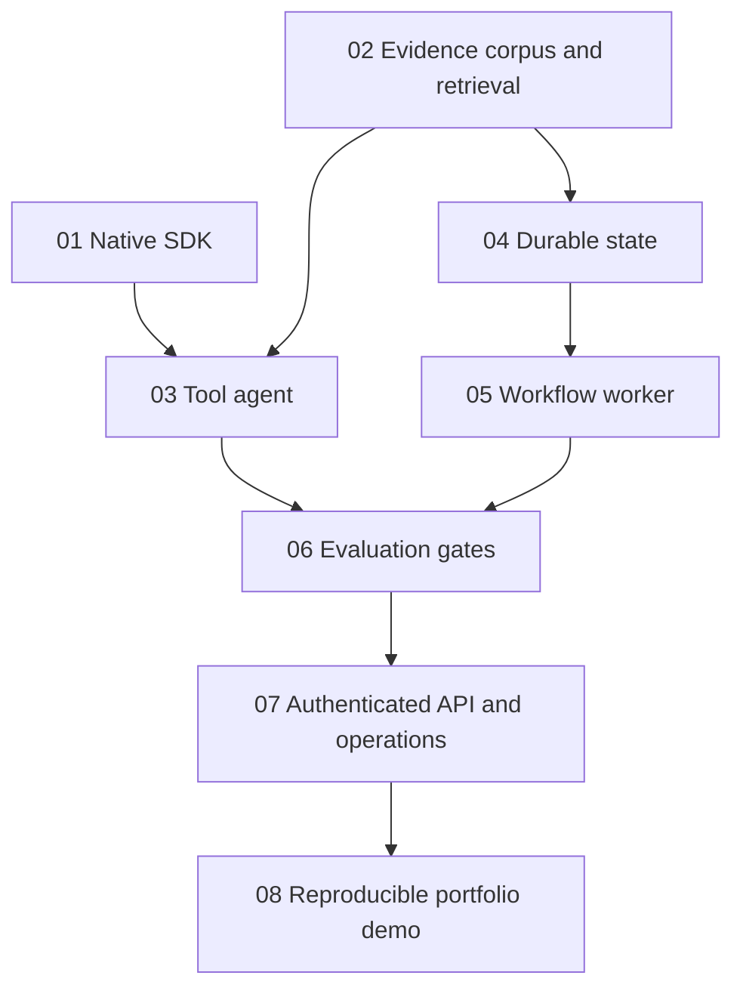
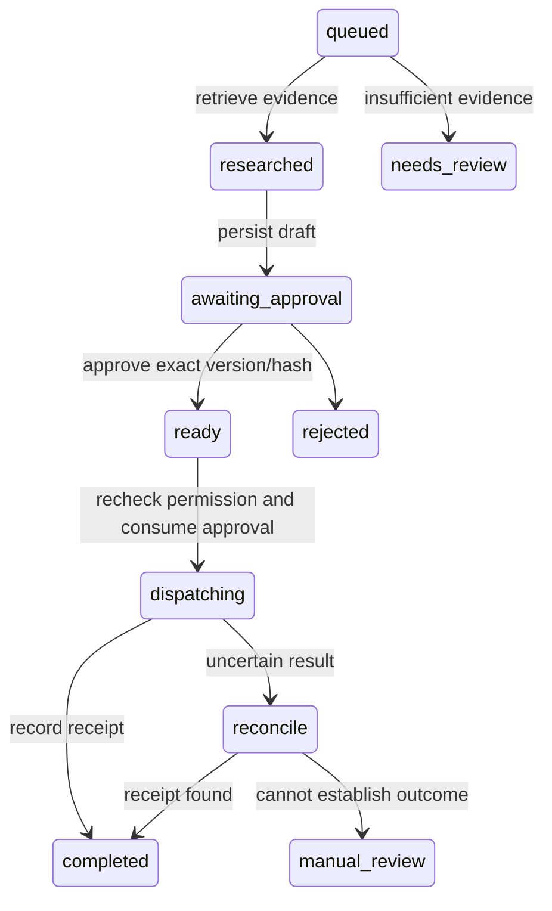

# Research engineering portfolio

The projects demonstrate a research-to-review workflow over synthetic company policy documents. Each numbered folder owns a runnable project; later projects compose earlier packages through explicit dependencies. This structure follows the user's correction recorded in D020.

## Architecture

The model proposes tool calls. The tool registry validates schemas and checks trusted permissions before adapters execute. Research runs, exact action payloads, approvals and delivery receipts are authoritative database records. Conversation text cannot approve an action. The fake outbox provides stable receipt lookup for simulated interruption recovery.

## Evidence index

| Project | Capability | Inspectable evidence |
| --- | --- | --- |
| [01](../01-native-llm-sdk/README.md) | Native SDK, JSON/SSE, deadlines, redaction | provider/service source; 26 offline transport tests |
| [02](../02-retrieval-and-evidence/README.md) | Versioned ingestion, BM25 ranking, citation resolution | retrieval source, corpus labels, evidence/retrieval-report.json |
| [03](../03-tool-calling-agent/README.md) | Strict tool loop and deterministic permissions | agent/tools source, malformed/denied/timeout/replay fixtures |
| [04](../04-persistence-and-state/README.md) | Durable ownership, transactions, migrations, quota | store/db source, restart/rollback/concurrency/backup tests |
| [05](../05-durable-workflows/README.md) | Approval and crash recovery | worker source, changed-payload/expiry/revocation/uncertain-provider tests |
| [06](../06-evaluation-and-observability/README.md) | Measured regression gates | offline-report.json; deliberate citation-regression test |
| [07](../07-production-engineering/README.md) | Authenticated API, tenant boundaries, operations | API tests, trace test, load.json, RUNBOOK.md, infra/ |
| [08](README.md) | Reproducible evidence package | project-verification.json, tests.xml, demo.json and demo.trace.jsonl |

All source and tests reside inside their respective project folders. See [progress](../docs/PROGRESS.md) for the acceptance state of each project.

## Design choices and observed failure

BM25 is an inspectable no-key baseline. Exact character-offset citations resolve back to retained document versions. The synthetic evaluation records retrieval recall separately from exact expected-quote support and citation validity. A paraphrased question can miss despite having an answer in the corpus; the report includes that failure. Conflict detection relies on declared claim metadata and cannot detect arbitrary contradictions.

The workflow uses a transactional state machine instead of adding an orchestration server. Leases fence concurrent workers; an action ledger and receipt lookup handle crash-after-delivery uncertainty. This establishes tested internal invariants for the fake adapter. Real external systems require their own idempotency/reconciliation contracts.

The scripted agent demo searches evidence, then proposes an unavailable send tool. The trace records unknown_tool under the same request ID, showing why the operation did not execute. The API demo also rejects missing authentication and approval replay, and reopens persisted work after application restart.

## Reproduce

From this folder run `uv sync --locked`, `uv run pytest tests -q`, then `uv run python -m research_portfolio`. From the workspace root run `uv sync --locked --all-packages` and `uv run --all-packages pytest -q`. Every project's README contains its own run/test commands.

## Limits and remaining gates

No live model quality, usage or cost baseline has been measured. Offline scripted tool trajectories do not prove live model tool selection. PostgreSQL cases require a working disposable server; container and hosted rollback/restore checks remain pending. The user deferred cloud hosting. The local load sample excludes network and provider latency. No independent annotation study or calibrated judge exists yet; stage10 remains planned. Stage09 inference is also planned.

This is a reproducible local portfolio, with external validation gaps disclosed. It is not a claim that all original production deployment acceptance gates have passed.
